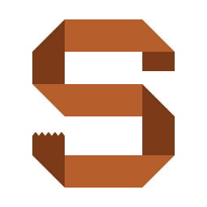

# The sous brand

The mark is one strip of order ticket, the paper slip that hangs over the pass in a kitchen. It is
folded four times at 45 degrees into an S. The bars show the front of the paper and the uprights
its back, in a darker copper. The strip starts as a short tab under the top bar and ends torn,
bottom left, where the ticket came off the printer.

A sous chef takes the orders and runs the line, which is what sous does with your agents.

## Files

| File | Use it for |
| --- | --- |
| `mark.svg` | the mark on a light background |
| `mark-dark.svg` | the mark on a dark background |
| `mark-mono-black.svg`, `mark-mono-white.svg` | one colour only, such as print, stamps or embossing. A gap at each fold keeps the folds readable. |
| `mark-small.svg` | 24 px and below. It is drawn on a 16 px grid, with no teeth on the torn end. |
| `favicon.svg`, `favicon.ico` | browser tabs. The SVG turns to the dark colours in a dark browser. |
| `app-icon.svg`, `app-icon-512.png`, `apple-touch-icon.png` | an app or home screen icon: the dark mark on an ink tile |
| `lockup-light.svg`, `lockup-dark.svg` | the mark and the name together, as in the README header |
| `wordmark.svg` | the name alone, when the mark is already on the page |
| `mark-512.png`, `mark-dark-512.png` | places that take no SVG |
| `social-preview.png` | the GitHub social preview, 1280 by 640 |

`node docs/brand/make.mjs` writes every SVG here from the geometry in that file. The PNGs and the
ICO were rendered from the SVGs with headless Chrome. The social preview sets its line in IBM Plex
Sans, under the SIL Open Font License.

## Colours

| Name | Hex | Use |
| --- | --- | --- |
| Copper | `#B5602A` | the front of the strip, on light |
| Deep copper | `#7A3A16` | the back of the strip, on light |
| Copper on dark | `#DB8550` | the front of the strip, on dark |
| Deep copper on dark | `#9C4F25` | the back of the strip, on dark |
| Ink | `#1D1A16` | the wordmark on light, the app icon tile |
| Page | `#FBF8F2` | a light background |
| Char | `#16130F` | a dark background |
| Cream | `#F2EBDD` | the wordmark on dark |

## Rules

- Leave clear space around the mark at least as wide as the strip.
- Use the small cut at 24 px and below, and the full mark above.
- Keep the two coppers together. The front is always the lighter one.
- Don't rotate, mirror or outline the mark, and don't set the wordmark in another font.
- Don't put the colour mark on a busy photo or a mid-tone background. Use a mono cut there.
- Write the name in lowercase, sous, even at the start of a sentence.
